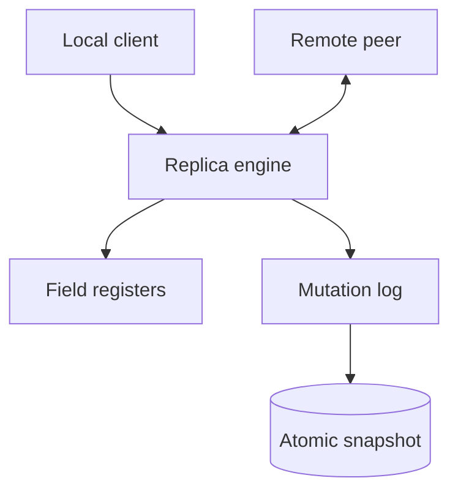

# Architecture

SyncMesh is an operation-based, field-level last-writer-wins map with causal metadata. Each replica accepts local mutations, materializes document registers, and retains an operation log for delta exchange.

## Mutation lifecycle

1. The replica merges every observed vector clock into its frontier.
2. A local write increments its actor component.
3. A hybrid logical timestamp is generated from physical time and observed remote time.
4. The mutation body is canonicalized and SHA-256 addressed.
5. Each changed field is compared with its current register.
6. The operation is retained for peer delta queries and the snapshot is atomically replaced.

## Core invariants

- Applying a valid mutation more than once has no additional effect.
- Causally newer values always replace causally older values.
- Concurrent values use the same total ordering at every replica.
- Disjoint fields do not conflict and both survive synchronization.
- A replica frontier is the component-wise maximum of every applied mutation clock.
- A snapshot frontier must equal the frontier reconstructed from its mutation set.

## Deletes

Deletion is a reserved `$deleted` register. Ordinary edits write `$deleted = false` in the same mutation, so a causally later edit restores a deleted document and a concurrent edit/delete pair follows the same deterministic rule as any other field. User fields remain in state while deleted, allowing a later causally valid restore without inventing data.

## Persistence

The reference snapshot stores the mutation log in a checksummed envelope, writes a new mode-`0600` file, calls `fsync`, and atomically renames it. A server restart rebuilds materialized registers by replaying mutations. This keeps the persisted source of truth small and auditable.

For large datasets, use segment-based operation storage plus periodic materialized checkpoints. Compaction is safe only after a trusted stability frontier proves every required peer has observed the operations being removed.
