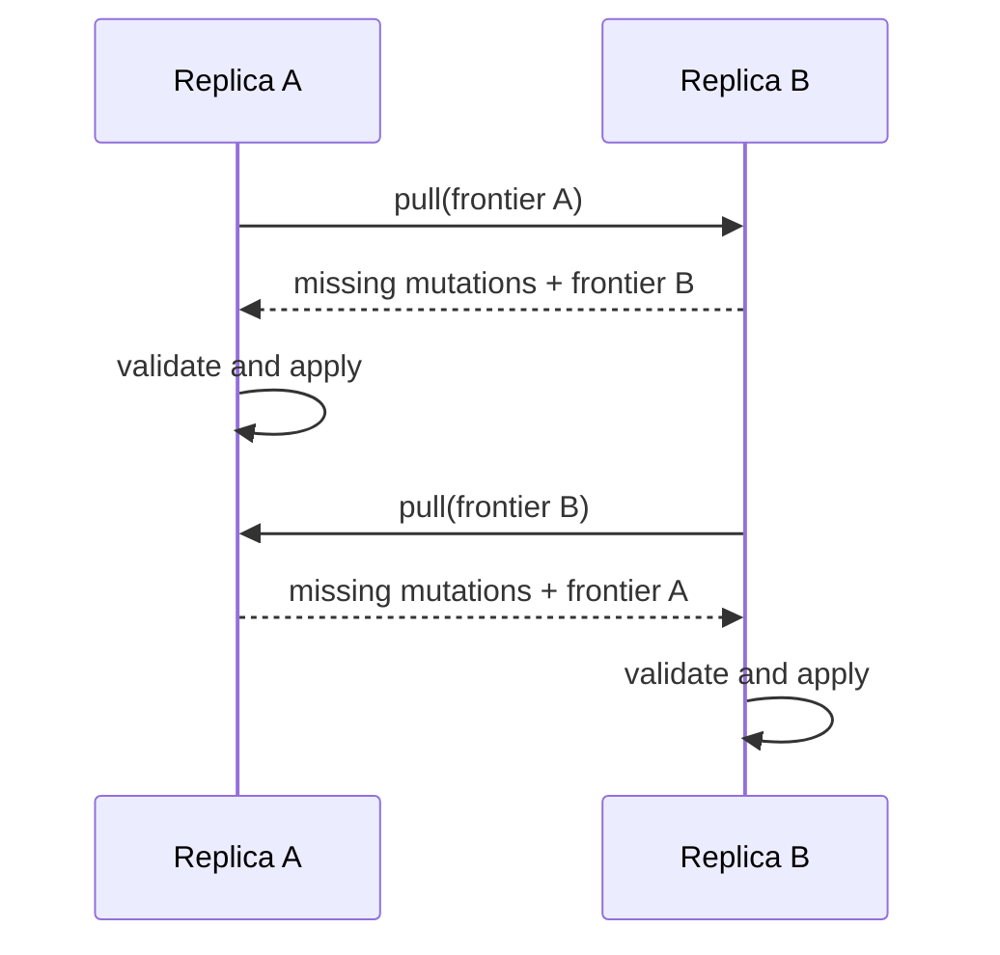

# Sync protocol

The reference HTTP protocol uses frontier exchange. All messages are JSON and mutations are self-validating through their content address.

## Pull

1. Peer A requests `GET /v1/sync/summary` from peer B.
2. Peer A sends its own frontier to `POST /v1/sync/pull` on peer B.
3. Peer B returns mutations whose clocks are not covered by A's frontier.
4. Peer A validates and applies them through `POST /v1/sync/push` locally or directly in its embedded engine.
5. Peers repeat in the opposite direction.

## Retry behavior

Push is idempotent by mutation ID. A client may safely resend a batch after losing the response. The response reports how many previously unseen mutations were applied.

## Validation and limits

- mutation IDs must match SHA-256 of canonical content;
- actor IDs and vector-clock counters are validated;
- request bodies are limited to 2 MiB;
- push batches are limited to 1,000 mutations;
- document IDs and field names use bounded safe character sets.

Production peers should authenticate each other, authorize actor namespaces, limit clock width, paginate delta batches, compress transport, and reject timestamps outside an agreed skew window.
